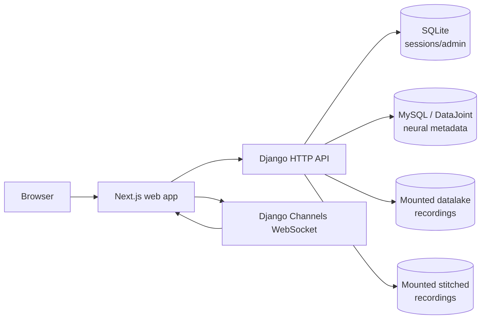

# Elias Search

Elias Search is a web app for searching EMU neural recording metadata across raw datalake recordings and stitched recording outputs. It provides a Next.js frontend for building queries, a Django backend for authentication and query execution, and a DataJoint/MySQL-backed model layer for reading neural metadata.

The main workflow is browser-based: log in, choose query filters, run the search, monitor progress, inspect the result table, and download matching recording metadata as CSV. The app is designed primarily for web deployment, with Docker Compose files included for local development and production-style service orchestration.

## Architecture



The frontend lives in `elias-search-web` and is responsible for login screens, query controls, progress display, result pagination, and CSV export. The backend lives in `elias-search-server` and exposes HTTP endpoints plus a WebSocket progress channel.

Queries can run in two source modes:

- `datalake`: searches source recording chunks and derives timing/file information from mounted datalake files.
- `stitched`: searches stitched chunk metadata and resolves timing against source chunk information.

## Prerequisites

- Docker and Docker Compose for the recommended setup.
- Node.js and npm for frontend-only development.
- Python 3.11 for backend-only development.
- Access to the required DataJoint/MySQL schema.
- Read-only access to the datalake and stitched recording directories used by your deployment.
- SSH/GitHub access for the current Python dependencies installed from Git URLs, unless those dependencies have been made public, vendored, or replaced in your fork.

## Configuration

Create environment files from examples before running the app. Real `.env` files can contain credentials and local paths, so they should not be committed.

Recommended root `.env.example` shape:

```bash
ENVIRONMENT=dev
DJ_USER=your_datajoint_user
DJ_PASSWORD=your_datajoint_password
DJ_HOST=mysql.example.org
DJ_PORT=3306
DATALAKE_PATH=/path/to/datalake
STITCHED_PATH=/path/to/stitched
BACKEND_URL=http://localhost:8080
WEBSOCKET_URL=ws://localhost:8080
NEXT_PUBLIC_BACKEND_URL=http://localhost:8080
NEXT_PUBLIC_WEBSOCKET_URL=ws://localhost:8080
```

Recommended `elias-search-web/.env.example` shape:

```bash
NEXT_PUBLIC_BACKEND_URL=http://localhost:8080
NEXT_PUBLIC_WEBSOCKET_URL=ws://localhost:8080
```

The current Next.js configuration uses the production-style base path `/emu/search`. Depending on how you run the app, local URLs may be direct service ports such as `http://localhost:3000` or `http://localhost:3001`, while deployed URLs may include the configured base path and reverse proxy.

## Installation And Running

### Docker Compose

Docker Compose is the recommended way to run the full stack.

```bash
cp .env.example .env
# edit .env with your database credentials, service URLs, and mounted data paths
bash scripts/prepare_runtime_files.sh db.sqlite3 dj_log.log
docker compose up --build
```

The production-style compose file publishes:

- Frontend: `http://localhost:3000`
- Backend: `http://localhost:8080`

The preparation command creates missing SQLite and log files without overwriting
existing files. Django's startup migrations initialize a new, empty SQLite file.
If either path is a directory or symlink, preparation stops so you can inspect it
and move it aside deliberately. The file bind mounts disable automatic directory
creation, so skipping preparation produces a missing-source error.

The helper script `./start_service.sh` prepares these files automatically, sources `.env`, builds with Docker BuildKit/SSH forwarding, starts the stack, and follows server logs. Use it when your environment needs SSH access to install private Git dependencies:

```bash
./start_service.sh
```

### Development Compose

```bash
cp .env.example .env.dev
# edit .env.dev for local development
bash scripts/prepare_runtime_files.sh dj_log.log
docker compose -f docker-compose-dev.yml up --build
```

The development compose file publishes:

- Frontend: `http://localhost:3001`
- Backend: `http://localhost:8081`
- Optional Nginx reverse proxy: `https://localhost:8444`, if configured with local certificates

The helper script `./start_service_dev.sh` prepares the log file automatically, sources `.env.dev`, builds with Docker BuildKit/SSH forwarding, and starts the development stack:

```bash
./start_service_dev.sh
```

### Frontend-Only Development

Use this when a backend is already running elsewhere.

```bash
cd elias-search-web
npm install
cp .env.example .env.dev
# edit .env.dev to point at your backend and websocket URLs
npm run dev
```

The frontend development server runs on port `3001` by default.

### Backend-Only Development

Use this when you want to run the Django service outside Docker.

```bash
cd elias-search-server
python -m venv .venv
source .venv/bin/activate
pip install -r requirements.txt
python manage.py migrate
python manage.py runserver 0.0.0.0:8081
```

For WebSocket support in a backend-only setup, run the ASGI app with Daphne instead of Django's development server:

```bash
daphne -b 0.0.0.0 -p 8081 es_server.asgi:application
```

Backend development requires the DataJoint/MySQL configuration and mounted recording paths to match your environment.

## Usage

1. Open the web app in a browser.
2. Log in with credentials accepted by the configured authentication backend.
3. Choose query filters:
   - Tasks, all tasks, all data, and stimulation exclusion.
   - Patients.
   - Brain regions (keeps patients with an electrode contact in a selected region).
   - Date-time range.
   - Days of stay.
   - Time of week.
   - Source mode: `datalake` or `stitched`.
4. Run the query and watch progress updates.
5. Review the paginated results table.
6. Download results as CSV when needed.

Query results are returned as a table with columns for patient, file, start time, duration, end time, available file types, NSP id, and source mode.

## API Reference

The frontend is the canonical client for this API. The API is not currently versioned.

| Method | Path | Purpose |
| --- | --- | --- |
| `GET` | `/ping/` | Health check endpoint. |
| `POST` | `/auth/login/` | Authenticate a user and create a session. |
| `GET` | `/auth/status/` | Check whether the current session is authenticated. |
| `POST` | `/auth/logout/` | Clear the current authenticated session. |
| `GET` | `/query/formdata` | Fetch patients, tasks, brain regions, and max day-of-stay values for query controls. |
| `POST` | `/query/db` | Execute a metadata query and return column-oriented results. |
| `WS` | `/ws/query-progress/<session_id>` | Stream query progress messages for a submitted query. |

## Adding New Features

### Add A Frontend Filter

1. Add or update a control under `elias-search-web/app/(components)/QueryForm`.
2. Add state and payload fields in `QueryForm.tsx`.
3. Update backend query handling in `QueryBuilder` so the new payload field affects results.
4. Keep defaults explicit so existing query behavior stays predictable.

### Add A Backend Query Condition

1. Add or update Django model mappings if the condition needs more DataJoint tables.
2. Add a focused filter method in `QueryBuilder`.
3. Insert the filter into `waterfall_query` for `datalake`, `stitched`, or both modes.
4. Preserve progress messages so long-running queries remain observable from the UI.
5. Make sure result formatting still produces table-compatible, column-oriented JSON.

### Brain Region Filtering

Brain-region filtering is a patient-level filter driven by the `AreaFsVox` DataJoint
table, which holds the FreeSurfer label of the voxel each macro contact sits in.
An electrode montage applies to a whole admission, so selecting a region keeps every
recording from admissions with at least one contact localized to it.

- `elias-search-server/es_server/brain_regions.py` enumerates the FreeSurfer
  `aparc+aseg` labels offered by the form. Labels are grouped for display and carry
  the alternate spellings FreeSurfer versions disagree on, so a selection made in the
  browser still matches data written by another version.
- `/query/formdata` serves that catalog, appending any `area_fs_vox` value present in
  the database that the catalog does not already cover.
- `QueryBuilder._region_query` turns the selection into an admission filter for both
  `datalake` and `stitched` modes. It is skipped when the payload sets
  `allRegions`, which is the form default.
- The localization tables are populated separately from the recordings, so a missing
  `AreaFsVox` table degrades to an unfiltered query with a warning rather than an error.

### Add Output Columns

1. Extend `format_query_results` in the backend.
2. Keep response values column-oriented because `QueryResponse` converts the response dictionary into rows.
3. Check CSV export after adding columns.

### Add Auth Or Deployment Behavior

Keep environment-specific values configurable. Avoid hardcoding hostnames, credentials, internal paths, or deployment-only assumptions in application code.

## Testing And Validation

Current validation is mostly manual and smoke-test oriented.

Runtime file preparation regression tests (Python standard library only):

```bash
python3 -m unittest discover -s scripts/tests
```

Frontend build:

```bash
cd elias-search-web
npm run build
```

Backend syntax/import sanity:

```bash
cd elias-search-server
python -m py_compile manage.py es_server/*.py
```

Backend unit tests. These run against a throwaway SQLite database seeded with
synthetic electrode and recording rows, so they need neither the DataJoint/MySQL
deployment nor the mounted recording paths:

```bash
cd elias-search-server
python -m unittest discover tests
```

Full-stack smoke test:

1. Start the stack with Docker Compose.
2. Confirm `GET /ping/` returns a healthy response.
3. Open the login page.
4. Confirm `/query/formdata` returns patients, tasks, and max day-of-stay data.
5. Run a small sample query and confirm the UI renders a result table.
6. Download CSV and confirm the exported columns match the table.

Automated coverage is currently limited to the brain-region filter under `elias-search-server/tests`. Before broad public use, add focused tests for the remaining query payload handling, result formatting, authentication/session behavior, and frontend table/export behavior.

## Open Source Readiness

Before publishing this repository publicly:

- Confirm the `LICENSE` choice and copyright holder.
- Review the root and frontend `.env.example` files for any deployment-specific variables your release needs.
- Ensure real `.env` files, local databases, logs, credentials, and private paths are not committed.
- Move Django `SECRET_KEY`, `DEBUG`, allowed hosts, CORS origins, and deployment hostnames to environment-driven configuration.
- Generalize or remove institution-specific hostnames and reverse-proxy paths unless they are intentionally documented as examples.
- Decide whether the Git-based Python dependencies in `requirements.txt` will be public, optional, mirrored, or documented as access-controlled prerequisites.
- Consider adding `CONTRIBUTING.md` after the README stabilizes. Until then, keep contributor guidance in this README.

## Repository Layout

```text
.
+-- docker-compose.yml          # Production-style compose stack
+-- docker-compose-dev.yml      # Development compose stack
+-- nginx/                      # Optional reverse proxy configuration
+-- elias-search-server/        # Django, Channels, DataJoint/MySQL backend
`-- elias-search-web/           # Next.js frontend
```
